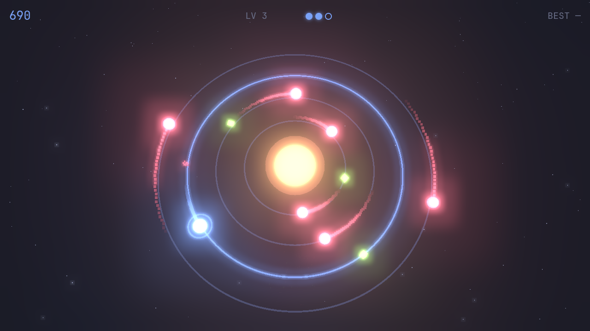

# Eclipse

**Orbit a dying star. Hop between rings, dodge comets, outrun its flares.**

A small, fast, hard orbital survival game for [Omarchy](https://omarchy.org)'s **Game Vibes**, built with three.js as a single HTML file. It takes on your desktop theme's colours, glowing with bloom in dark themes and staying crisp in light ones.



## Install

On Omarchy, open the menu and go to **Install › Gaming › Game Vibes**, then paste this repository's URL. Or use the terminal:

```bash
omarchy games vibes install https://github.com/DeV-433/omarchy-eclipse-game
```

Then launch **Game Vibes** from the app launcher (<kbd>Super</kbd> + <kbd>Space</kbd>) and choose **Eclipse**.

### Without Omarchy

It's a single `index.html`. In Game Vibes it uses the local copy of three.js, so it plays offline; anywhere else it fetches three.js from a CDN, so any modern browser with WebGL can run it:

```bash
git clone https://github.com/DeV-433/omarchy-eclipse-game
xdg-open omarchy-eclipse-game/index.html    # or open it in your browser
```

## How to play

Your moon circles a star on one of four rings and never stops moving. Stay alive as long as you can.

| Key | Action |
| --- | --- |
| <kbd>↑</kbd> / <kbd>W</kbd> | Hop out to the next ring |
| <kbd>↓</kbd> / <kbd>S</kbd> | Hop in to the next ring |
| <kbd>←</kbd> / <kbd>A</kbd> | Brake your orbit |
| <kbd>→</kbd> / <kbd>D</kbd> | Boost your orbit |
| <kbd>Space</kbd> | Phase through danger (uses a charge); start a round |
| <kbd>Esc</kbd> / <kbd>P</kbd> | Pause and resume; on the title screen, back to Game Vibes |
| <kbd>Q</kbd> | While paused, back to Game Vibes |
| <kbd>M</kbd> | Sound on or off |
| <kbd>?</kbd> | Controls |

### What's out there

- **Comets** (red) fly the opposite way along a ring. Hop out of their path. If one passes close without hitting you, that's a graze and earns bonus points.
- **Comet walls** (level 2+) fill every ring but one. Find the gap.
- **Flares** (level 3+): a red lane flickers out from the star, aimed at **where you will be** when it fires. Brake, boost, or change rings to get out of it. Inner rings go around faster, outer ones slower.
- **Mines** (level 4+): a magenta warning ring appears, then a crystal arms on that spot.
- **Motes of light** (green): collect them for points. Collecting them quickly builds a combo of up to **x8**. Every 4 motes earns a **phase charge** (up to 3), which makes you briefly untouchable.

One hit and the star is eclipsed. A new level starts every 15 seconds, and each one is faster and busier than the last. Your best score is saved.

## Files

- `index.html`: the whole game
- `icon.svg`: the tile shown in Game Vibes

## License

MIT
